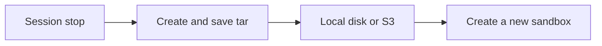

Filesystem snapshots capture a stopped sandbox’s root disk as one tar and store it at `snapshots/{sandbox_name}/snapshot_{snapshot_id}.tar`. Restore always creates a **new** sandbox. Named volumes are not included.



## Creation methods

| Method | When | How to opt out / confirm |
| --- | --- | --- |
| Automatic | A **persistent** sandbox session stops (`stop()`, or `max_duration_secs` / `idle_timeout_secs`) | Set `lifecycle.ephemeral=true` |
| Manual | `POST /v1/sandboxes/:id/snapshots` or `cellar sandbox snapshot <name> --stop` | `--stop` / `"stop": true` is required |

Persistent is the default. Automatic snapshots use `snapshotExpiration` (default **30 days after last use**) and `keepLastSnapshots`.

The VM must be stopped to capture. `cellar sandbox snapshot … --stop` shuts the sandbox down and leaves it stopped. Manual create returns immediately with `status=creating`; poll `inspect` or `GET /v1/snapshots/:id` until `created` or `failed`.

```bash
sudo cellar sandbox snapshot demo --stop
sudo cellar sandbox snapshot demo --stop --expiration 14d
sudo cellar sandbox snapshot demo --stop --expiration 0   # never expire
```

## Restore

Create a new sandbox from a snapshot. `start` is optional. Local-backend snapshots restore only on the node that captured them; S3-backend snapshots can restore on any live node.

```bash
sudo cellar sandbox create --name demo2 --from-snapshot <snapshot-id>
sudo cellar sandbox create --name demo2 --from-snapshot <snapshot-id> --start
```

```bash
curl -H "Authorization: Bearer $KEY" -X POST http://127.0.0.1:8080/v1/sandboxes \
  -d '{"name":"demo2","source":{"type":"snapshot","snapshot_id":"..."}}'
```

Creating or restoring from a snapshot resets `last_used_at`. `sandbox rm` does not delete snapshot objects — snapshots outlive the sandbox.

## Retention

Tune defaults after create:

```bash
sudo cellar sandbox update <id> --snapshot-expiration 7d --keep-last-snapshots 1
```

```bash
curl -H "Authorization: Bearer $KEY" -X PATCH http://127.0.0.1:8080/v1/sandboxes/$ID \
  -d '{"snapshot_expiration":"7d","keep_last_snapshots":1}'
```

- `snapshot_expiration` — TTL after last use. Omit for **30 days**. `0` / `none` never expires. A per-call `expiration` on manual snapshot overrides the sandbox default.
- `keep_last_snapshots` — keep the N newest snapshots for that sandbox (1–10), including manual ones. Evicted rows are deleted from Raft and the blob backend when `delete_evicted` is true (default).

The leader deletes expired objects on a ticker. Status `deleted` is omitted from the default list; `GET` by id still returns the record.

## Storage

S3 is **optional**. `cellard` always has a blob backend:

- **Local (default)** — `{data-dir}/snapshots/{name}/snapshot_{id}.tar` on the node that captured the VM.
- **S3** — set `CELLAR_S3_BUCKET` / `--s3-bucket`. The object key is the same relative path (plus optional `--s3-prefix`).

A local snapshot can only be restored on the capturing node. If that node is gone, restore fails. Use S3 or MinIO if restores must survive node loss. Tars are not copied between nodes.

```
--snapshot-dir / CELLAR_SNAPSHOT_DIR   # local root (default {data-dir})
--s3-bucket    / CELLAR_S3_BUCKET
--s3-region    / CELLAR_S3_REGION
--s3-prefix    / CELLAR_S3_PREFIX
--s3-endpoint  / CELLAR_S3_ENDPOINT    # MinIO / S3-compatible
```

Missing S3 does not skip automatic snapshots and does not fail `snapshot --stop`. Switching a running cluster from local to S3 does not migrate old bundles; new snapshots use the configured backend.

## Session timers

If `lifecycle.max_duration_secs` or `lifecycle.idle_timeout_secs` is set, microsandbox stops the VM when the timer fires. Cellar then:

1. Reports `phase=stopped` (does **not** reap/destroy the disk).
2. Flips `desired_state` to `stopped`.
3. Takes an automatic snapshot when the sandbox is persistent.

There is no auto-restart after duration or idle.

## CLI

```bash
sudo cellar sandbox snapshot <id-or-name> --stop [--expiration 14d|0]
sudo cellar sandbox update <id> --snapshot-expiration 7d --keep-last-snapshots 1
sudo cellar sandbox create --name demo2 --from-snapshot <snapshot-id> [--start]

sudo cellar snapshot ls
sudo cellar snapshot ls --sandbox demo
sudo cellar snapshot inspect <snapshot-id>
sudo cellar snapshot rm <snapshot-id>
```

## HTTP API

All routes need `Authorization: Bearer cellar_…` or `X-Api-Key`.

| Method | Path | Body |
| --- | --- | --- |
| POST | `/v1/sandboxes/:id/snapshots` | `{ "stop": true, "expiration": "14d" }` (`stop` required) |
| GET | `/v1/sandboxes/:id/snapshots` | list for one sandbox |
| GET | `/v1/snapshots/:id` | inspect |
| DELETE | `/v1/snapshots/:id` | delete metadata and the tar |
| PATCH | `/v1/sandboxes/:id` | `{ "snapshot_expiration": "7d", "keep_last_snapshots": 1 }` |
| POST | `/v1/sandboxes` | `"source": { "type": "snapshot", "snapshot_id": "..." }` |

```bash
curl -H "Authorization: Bearer $KEY" -X POST http://127.0.0.1:8080/v1/sandboxes/$ID/snapshots \
  -d '{"stop":true,"expiration":"14d"}'
```

## Out of scope

- Fork-in-place of the same sandbox id
- Snapshotting named volumes
- Copying snapshot tars onto other nodes
- Migrating existing local snapshots into S3
